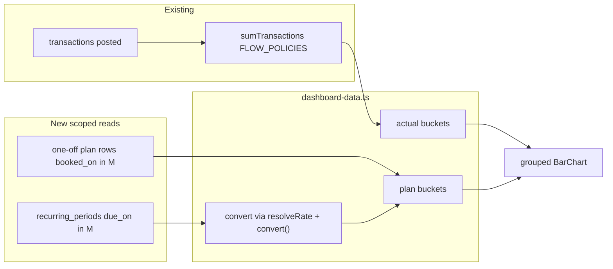

# Dashboard cash-flow: whole-month plan beside actual

| Field              | Value |
| ------------------ | ----- |
| **Status**         | draft |
| **Issue**          | #840  |
| **Spec PR**        | #841  |
| **Implementation** | none  |

## 📝 TLDR

Workspace members who plan with one-off planned transactions and with recurring periods cannot see that plan on the dashboard. The cash-flow chart today answers only “what moved”. This spec adds a **separate planned series** for each month: the **whole month’s plan** (one-off planned rows plus recurring occurrences due that month, **regardless of paid status**) drawn **beside** actual money in and money out. Actual figures stay byte-identical to today. The dashboard **may** sum `expected_amount_minor` for this chart only — an explicit exception to plan 13-S1, recorded in this PR.

## 📝 Problem Statement

The dashboard loader (`src/routes/_app/dashboard/-server/dashboard-data.ts`) builds cash-flow buckets with `sumTransactions` under `FLOW_POLICIES` (`planned: 'exclude'`). It never reads `is_planned = true` rows or `recurring_periods`. `/transactions/planned` already merges one-off planned rows with recurring expectations at read time (`.ai/specs/2026-09-20-recurring-periods-settle-and-surface.md`) and keeps those expectations out of ledger totals. The home chart still only shows what posted.

Two planning models exist and stay distinct (owner: do **not** unify them in this ticket):

| Model                       | Storage                                                         | Base-currency figure                                         |
| --------------------------- | --------------------------------------------------------------- | ------------------------------------------------------------ |
| One-off planned transaction | `transactions.is_planned`                                       | Has `ref_amount_minor` at `booked_on` (`docs/MONEY.md` §3.1) |
| Recurring occurrence        | `recurring_periods` (`due_on`, `expected_amount_minor`, status) | **No** `ref_amount_minor` until it settles (13-S1)           |

A person who uses either (or both) has to add figures in their head to answer “what was this month supposed to look like, versus what moved”.

Evidence this matters: issue #840 (owner request, 2026-11-03). All examples in this spec are **synthetic**.

## 📝 Owner decisions (Rafał, 2026-11-03)

These are product law for this spec. They are not open questions.

### D1 — Dashboard exception to 13-S1

The dashboard **may** sum expected amounts of recurring occurrences. This is an **explicit exception** to `docs/plans/13-recurring.md` 13-S1 (“`expected_amount_minor` is never summed into a report”), **for the dashboard cash-flow planned series only**.

- Every other report, total, and the dashboard **actual** series still sum `transactions.ref_amount_minor` only.
- The planned series is labelled as a plan, never as money that moved.
- The exception is written into plan 13 in this same design PR.

### D2 — “Planned” is the whole month’s plan

On the chart, **planned for month M** is:

- every **one-off** planned transaction whose `booked_on` falls in M, **plus**
- every **recurring period** whose `due_on` falls in M, **regardless of status** (upcoming, overdue, **paid**),

compared with what was **actually** paid or received in M.

It is **not** “what is still open”. Past months show their full plan against their actuals.

The mapping, double-counting rule, posted one-off rule, skipped-period rule, and conversion rule are defined below so D2 can be implemented without inventing arithmetic.

## 📝 Proposed Solution

Keep two questions, two integer series, one chart:

1. **Actual** — unchanged `FLOW_POLICIES` over posted transactions (`ref_amount_minor`, workspace base currency). Header “Money in” / “Money out” stay `sumMinor` over in-period actual buckets.
2. **Plan** — a new labelled pair of series (`plannedIncomeMinor` / `plannedExpenseMinor`) on the same month buckets. Never folded into the header actuals.

**Why not one stacked “remaining + actual” bar.** The owner chose whole-month plan vs paid, not a projection of leftovers. Stacking would mix a plan with a fact and would violate the widget’s “grouped, never stacked” rule (`cash-flow-widget.tsx`).

**Why not materialise recurring periods as planned `transactions` rows.** That unifies the two models. The owner left it independent. This spec composes at read time, the same seam `/transactions/planned` already uses.

**Why one spec, not two (one-off vs recurring).** A cohesion pass can ship either source as its own labelled series. D2’s definition of “planned” is the **pair** on the same chart. Splitting would ship a dashboard that still fails the owner’s sentence. The two reads stay separate modules; the user-facing capability is one.

### Alternatives considered

| Alternative                                                          | Why it lost                                                                              |
| -------------------------------------------------------------------- | ---------------------------------------------------------------------------------------- |
| Remaining-only planned series (unpaid periods + still-planned rows)  | Contradicts D2                                                                           |
| Convert expectations at “today’s” rate and show only the base figure | Forbidden by 13-S1’s display rule and by `docs/MONEY.md` §3.1 (a live revalue of a plan) |
| Write `ref_amount_minor` onto `recurring_periods`                    | Invents a historical fact the period does not have; §3.1 is for booked rows              |
| Count a paid period’s expected amount inside actual                  | Double-counts inside actual; D2 forbids it                                               |
| Spending-donut planned slices                                        | Independent; deferred                                                                    |
| Unify one-off planned with recurring periods                         | Independent; deferred                                                                    |

## 📝 Architecture

**Owner modules** (`docs/SPEC.md` §8):

| Concept                              | Owner                                                                                                                                                                                                                              |
| ------------------------------------ | ---------------------------------------------------------------------------------------------------------------------------------------------------------------------------------------------------------------------------------- |
| Actual cash-flow buckets             | `dashboard-data.ts` `cashFlowBuckets()` — **unchanged query**                                                                                                                                                                      |
| Whole-month plan per month           | New tenant-scoped reads in `src/server/repos/recurring.ts` and `src/server/repos/transaction-queries.ts` (or `transactions.ts`)                                                                                                    |
| Display conversion of an expectation | Dashboard `-server/` composition calling existing `resolveRate` (`src/server/repos/workspace-currencies.ts`) and `convert` (`src/lib/money.ts`, `docs/MONEY.md` §2.2) — **no SQL**, **no stored `ref_amount_minor` on the period** |
| Chart series                         | `src/components/app/dashboard/cash-flow-widget.tsx` + `types.ts` `CashFlowBucket`                                                                                                                                                  |
| 13-S1 exception text                 | `docs/plans/13-recurring.md` (this PR)                                                                                                                                                                                             |

**Layering (`docs/SPEC.md` §5.2, §6.1):** `TenantScope` is the first parameter of every new repository function. Zod on the server-function input and again in the repository. `components/ui` and `components/charts` still do not fetch and do not import `server/`. SQL stays in `src/server/repos`. No bank connector (ADR 0008).

**Takeaway:** actual stays a transaction sum; plan is a second, labelled aggregate. Conversion of expectations is a **read-time display step** for the chart, never a write onto the period.



## 📝 Data Model

### Recurring half (no new table)

`sumPlannedPeriodsByMonth(scope, { from, to })` in `src/server/repos/recurring.ts`:

- Tenant filter on `recurring_periods` **and** `recurring_series` (`src/server/repos/scope.ts`).
- Periods with `due_on` in `[from, to)` (calendar dates, `docs/MONEY.md` §6.1).
- **Include** status `upcoming`, `overdue`, `paid` (D2).
- **Exclude** `skipped` (a skipped occurrence is no longer part of the plan).
- **Exclude** `upcoming` / `overdue` rows whose series is paused or completed (`is_active = false` or completed): they are not a live plan. **Include** `paid` rows of those series: they were the month’s plan once they settled.
- Return per month, per `direction` (series direction), **per `expected_currency_code`**, integer `expected_amount_minor` sums. Do **not** convert in SQL.

`getUpcoming` stays window-based and unsettled-only. Do not overload it.

### One-off half — additive `was_planned`

Today, posting a planned row flips `is_planned` to false and leaves no trace that it was planned, so D2’s “whole month” would drop the item from the plan the moment it is paid.

**Fix (one additive migration, boolean, default false):** `transactions.was_planned`.

- Set `true` when a row is **created** with `is_planned = true`.
- Set `true` on the flip `is_planned true → false` if not already.
- Never cleared.
- A row created already posted stays `false`.

Plan membership for month M: `booked_on` in M **and** (`is_planned` **or** `was_planned`), same `adjustments` / `transfers` / `completeness` as `FLOW_POLICIES` (transfers out of the plan, as they are out of actual).

Amount: the row’s stored `ref_amount_minor` (`docs/MONEY.md` §3.1). No second money column. If the person edits the amount on the way to posting, plan and actual for that one-off use the same stored integers — the trace is “this row was the plan”, not a frozen pre-edit draft.

Migrations are additive only (`docs/SPEC.md` §6.1). Implementation of the column is Ask First at build time (auth/schema/money surface).

### No `ref_amount_minor` on periods

Do not add `ref_amount_minor` / `rate_e10` to `recurring_periods`. An expected amount still has no booking date until it settles (13-S1). Display conversion is computed at read and discarded.

## 📝 How plan maps to actual (no double count inside actual)

**Actual is only posted transactions.** A recurring period’s `settled_transaction_id` and a posted former-planned row each appear **once**, in actual, through the existing `sumTransactions` path. Expected amounts are **never** added into `incomeMinor` / `expenseMinor` / header totals.

| Item                             | Planned series                                                                           | Actual series                                                                                           |
| -------------------------------- | ---------------------------------------------------------------------------------------- | ------------------------------------------------------------------------------------------------------- |
| One-off still `is_planned`       | `ref_amount_minor`                                                                       | not included (`planned: 'exclude'`)                                                                     |
| One-off posted (`was_planned`)   | same `ref_amount_minor`                                                                  | same row, once                                                                                          |
| Recurring `upcoming` / `overdue` | converted expected (below)                                                               | not included                                                                                            |
| Recurring `paid`                 | converted **expected** (the period’s stored `expected_amount_minor`, not the settlement) | the **settled transaction** only, at its `ref_amount_minor`                                             |
| Recurring `skipped`              | excluded                                                                                 | only a settlement if one exists independently — `skipped` must not point at a required settlement today |
| Transfer                         | excluded                                                                                 | excluded                                                                                                |

**Remaining vs expected.** There is no “remaining” series. A paid period does **not** keep its expected amount as leftover **and** also show the settlement as actual in a combined total — because those two numbers live in **different series**. Variance (`settled − expected` in the series currency, integer, read-time) stays on the recurring screens; the dashboard does not draw it.

**Synthetic example (PLN, digits 2).** Rent expected 250_00, paid 250_00 in March:

- Planned out March = 250_00 (expected).
- Actual out March = 250_00 (settled row).
- Header money out = 250_00 (actual only).
- Not 500_00 anywhere.

**One-off that also settles a period.** If a posted (former planned) transaction is `settled_transaction_id` of a period due the same month, actual still counts the transaction once. Planned counts **both** the one-off’s `ref_amount_minor` **and** the period’s expected amount. That is honest to D2’s two sources; it can look “double” on the plan series when the person recorded the same event twice. This spec does **not** auto-dedupe (matching is `src/server/recurring/match.ts`’s job, and silent merge would hide a duplicate the person typed). The chart footnote does not mention this; it is an edge case for tests.

## 📝 Converting expected amounts that have no `ref_amount_minor`

Cite, do not restate, the arithmetic: `docs/MONEY.md` §1.1 (integer minor units), §1.2 (`currencies.digits`, never a hard-coded 2), §1.4 (half-to-even), §2.1 (`rate_e10`), §2.2 (the one `convert` function in `src/lib/money.ts`), §2.3 (rate resolution order), §3.1 (`ref_amount_minor` is historical and **never recomputed** — so this path **must not write** one onto the period).

For each period (or per-currency monthly sum in one currency) whose `expected_currency_code` **is** the workspace base: the integer `expected_amount_minor` **is** the chart figure. No conversion.

For each period whose currency **is not** the base:

1. Resolve a rate for `(expected_currency_code → base)` on **`due_on`**, through `resolveRate` (`docs/MONEY.md` §2.3): workspace flat rate if live updates are off, else catalogue rate for that day, else look-back up to 7 days. **Never “today”.**
2. Call `convert({ amount, to: base, rateE10 })` (`§2.2`). Integer in, integer out.
3. `sumMinor` the converted integers per month per direction.

**Failure (`§2.3` step 4).** No rate is invented. That period is a **gap** in the base-currency planned series (`null` / omitted from the sum, **not zero** — a zero would claim “we planned nothing”). Native `expected_amount_minor` still appears in the visually hidden table, in its own currency, with the existing rate-unavailable copy pattern (`failure.rate_unavailable` is a write-path sentence; dashboard uses a dedicated note key). A sentence under the chart states that some planned amounts could not be converted.

**Labelling.** Whenever any converted figure is in the planned series, the chart footnote (or a line under the legend) states that planned foreign-currency amounts are converted at each occurrence’s `due_on` rate, not at today’s rate, and are not historical `ref_amount_minor`. Native amounts remain in the data table.

**Never:** float; converting in SQL; converting at the request instant; showing **only** the converted number without the native row in the table; storing the converted integer on `recurring_periods`.

## 📝 API Contracts

No public HTTP surface. The dashboard loader already runs as a server function behind `requireOrg`.

New repository inputs (Zod twice: server function if any new one is added, and repository):

```ts
// shape, not permission
{
  from: CalendarDate, // inclusive YYYY-MM-DD
  to: CalendarDate,   // exclusive
}
```

Outputs: `{ monthKey: YYYY-MM-DD; direction: 'income' | 'expense'; currencyCode; amountMinor: Minor }[]` for periods (pre-conversion) and `{ monthKey; direction; amountMinor }` for one-off plan rows already in base via `ref_amount_minor`.

`loadDashboard` does not take a planned flag from the client. Scope comes from `requireOrg` only.

## 📝 UI/UX

Prototype: `.ai/specs/assets/dashboard-cash-flow-planned-vs-actual/mockup-01-cash-flow-planned.html`

- Route: `/` dashboard cash-flow widget. No new route.
- `BarChart` `layout="grouped"` stays. Four series, positional encoding (`DESIGN.md` → Charts): Money in, Money out, Planned in, Planned out. Planned series use the next palette slots (distinct marker **and** fill/outline pattern — colour is never alone).
- Money out and planned out remain **positive magnitudes**.
- Do not stack income with expense, or actual with plan.
- Visually hidden table gains two columns (or two extra series rows): planned in, planned out; native-currency lines when conversion ran or failed (`16-S1` / ADR 0007).
- Empty state: unchanged wording when **both** actual and planned are zero/absent; if only planned exists, **draw the chart** (today `hasMovement` looks only at actual — that predicate widens).
- Header totals: actual only. Optional separate labelled pair “Planned in” / “Planned out” for in-period months, **not** mixed into `dashboard.income` / `dashboard.expenses`.
- Keyboard: existing `BarChart` path (one Tab stop per series). Four series, not a new widget.
- Horizon: same buckets as today (`CONTEXT_MONTHS` when the period is one month). Planned is computed for every bucket the chart already draws, including context months.

Spending donut: **unchanged** in this spec.

## 📝 Edge Cases & Failure Scenarios

- **Skipped period:** not in plan.
- **Overdue period due in M:** in M’s plan even if still unpaid.
- **Paid period:** expected in plan; settlement in actual; not added together in one total.
- **Paused/completed series:** live (unpaid) periods out; historical paid periods in.
- **Foreign-currency expectation, rate missing:** gap in base planned series; native amount in table; labelled note; no invented rate.
- **Foreign-currency one-off planned:** uses stored `ref_amount_minor` (§3.1); not re-converted.
- **Duplicate one-off + period:** both in plan; actual once if they share one posted row.
- **Transfer planned row:** excluded from plan, as from actual.
- **Empty workspace / empty period:** existing empty state if nothing actual **and** nothing planned.
- **Tenant B’s periods:** never visible in A’s dashboard (isolation case).
- **Conversion overflow:** `convert` already throws; loader treats that period as a gap and logs internally without amounts in Sentry (`docs/MONEY.md` §7.4).

## 📝 Risks & Impact Review

- **13-S1 exception** is a product-direction change. It is scoped to one chart series. Rollback: stop reading the new fields and revert the widget to two series; actuals never changed.
- **`was_planned` column** is additive and reversible as “stop writing it”. Old posted one-offs stay invisible to the plan (accepted hole for history before the column).
- **Read-time conversion** can disagree with a later settlement’s `ref_amount_minor` (different `due_on` vs `booked_on`). That is correct: plan vs fact, not two facts.
- **Four grouped bars at 360px** are tighter than two. Encoding stays positional; if unreadable in QA, a follow-up may switch planned to overlay ticks without changing the integers.
- Unifying models or donut planned slices would widen blast radius; they are out of this spec.

## 📝 Decisions in play

No `product-brief.md` in this tree. Relies on ADR 0007 (charts), ADR 0008 (no bank connectors), ADR 0010 / `docs/MONEY.md` (ledger amounts), ADR 0016 (visual evidence at implementation). Amends plan 13-S1 as D1. Advances plan 18’s cash-flow widget without building `DASH-04` upcoming list.

## 📝 Visual change expected

Yes. `src/components/app/dashboard/**` cash-flow panel. Light and dark, 360 and 1280.

| State                                 | What changes                            |
| ------------------------------------- | --------------------------------------- |
| Current month with actual and planned | Four series, legend, table              |
| Month with planned only               | Chart draws; not the old empty state    |
| Past month with overdue expectation   | Planned bar present, actual may be zero |
| Foreign-currency note                 | Footnote + native rows in the table     |
| Empty (no actual, no planned)         | Empty state unchanged                   |

Implementation evidence: `.ai/qa/artifacts_*/`, synthetic seed only. This design PR’s mockup is illustrative HTML, not proof of behaviour.

## 📝 Copy

New catalogue keys, `en` text here; `pl` in the same implementation change (`i18n-messages`).

| Key                                   | en                                                                                                                                        |
| ------------------------------------- | ----------------------------------------------------------------------------------------------------------------------------------------- |
| `dashboard.plannedIncome`             | Planned in                                                                                                                                |
| `dashboard.plannedExpenses`           | Planned out                                                                                                                               |
| `dashboard.cashFlow.plannedNote`      | Planned amounts are the whole month’s plan, not only what is still unpaid.                                                                |
| `dashboard.cashFlow.convertedNote`    | Planned amounts in other currencies are converted at each due date’s rate, not today’s.                                                   |
| `dashboard.cashFlow.rateMissingNote`  | Some planned amounts have no exchange rate for their due date, so they are listed in their own currency and omitted from the chart total. |
| `dashboard.cashFlow.plannedInHeader`  | Planned in                                                                                                                                |
| `dashboard.cashFlow.plannedOutHeader` | Planned out                                                                                                                               |
| `dashboard.cashFlow.empty.title`      | (unchanged — still used when nothing actual **and** nothing planned)                                                                      |

No hardcoded strings. No `if (n === 1)` plural. Header actual labels `dashboard.income` / `dashboard.expenses` stay as they are.

## 📝 Research (open-source)

Firefly III and Actual Budget keep **posted** activity as the reportable fact; schedules/budgets are a separate layer. GnuCash scheduled transactions do not enter reports until posted. This spec follows that split: actuals are the existing transaction sum; the new series is explicitly a plan. None of those products is a source of copy, layout, or numbers here.

## 📋 Phasing

**Phase 1 — Reads, column, invariants.** Additive `was_planned`; `sumPlannedPeriodsByMonth`; one-off plan sum; conversion helper in the dashboard server module (or a small function next to `ref-amount.ts` that **does not persist**). Tenant-isolation and money-invariant cases. Dashboard UI unchanged — app still works.

**Phase 2 — Chart.** `CashFlowBucket` optional planned fields; loader composition; widget four series; copy; empty-state predicate; visual frames. No second migration.

Last phase of this spec is Phase 2. Spec merge must **not** close #840 (`Refs` only).

## 📋 Implementation Plan

### Phase 1

1. Failing tenant-isolation cases for the new period aggregate and the new one-off plan aggregate (`src/server/repos/__tests__/tenant-isolation.test.ts`): workspace A never sums B’s rows when ids, months, and currencies match.
2. Failing money-invariant cases (`src/server/repos/__tests__/money-invariants.test.ts`): actual `incomeMinor` / `expenseMinor` / `netMinor` byte-identical with and without planned data; paid period stays in plan at `expected_amount_minor` and settlement counts once in actual; skipped excluded; transfers excluded; no float; converted integers only via `convert`; missing rate is a gap not a zero; whole-month plan unchanged when a period flips to paid (except one-off `was_planned` behaviour as specified).
3. Additive migration: `transactions.was_planned` boolean not-null default false. Writers set it as specified. Repository parse with Zod.
4. Implement `sumPlannedPeriodsByMonth(scope, …)` — SQL only in `src/server/repos`.
5. Implement one-off plan sum under `TenantScope` (extend `sumTransactions` with a dedicated policy **or** a sibling function so `FLOW_POLICIES` actual path is untouched).
6. Read-time conversion helper: `resolveRate` on `due_on` + `convert`; never write `ref_amount_minor` on a period.

### Phase 2

1. Extend `CashFlowBucket` with `plannedIncomeMinor` / `plannedExpenseMinor` (`Minor`). Header actuals still `sumMinor` of actual fields only.
2. `cashFlowBuckets()` composes plan reads; `hasMovement` includes planned; empty state only when both are empty.
3. `cash-flow-widget.tsx`: two extra `ChartSeries`; table headers; footnote keys; grouped layout unchanged.
4. EN + PL keys from the Copy table in one change.
5. Visual capture: light/dark, 360/1280, states in Visual change expected. `needs-qa` on the implementation PR (this spec PR is `skip-qa`).

## 📝 Resolved assumptions (autonomous defaults)

Owner D1 and D2 are **not** assumptions. Defaults below fill only what D2 left to the spec.

| #   | Question                                        | Applied default                                                                                   | Why                                                                                                                    | Confirm?              |
| --- | ----------------------------------------------- | ------------------------------------------------------------------------------------------------- | ---------------------------------------------------------------------------------------------------------------------- | --------------------- |
| Q1  | Do `skipped` periods count in the month’s plan? | **No.**                                                                                           | A skip is an explicit “this occurrence is not the plan”. Reversible.                                                   | reversible            |
| Q2  | How does a posted one-off stay in the plan?     | Additive `was_planned` boolean; plan uses stored `ref_amount_minor`.                              | Lowest-schema way to keep D2 after the flip; no extra money column.                                                    | reversible (additive) |
| Q3  | As-of date for converting expectations?         | `due_on` via `resolveRate` + `convert`, never today, never stored.                                | Matches when the occurrence was supposed to happen; obeys `docs/MONEY.md` §2.3 / §3.1.                                 | reversible            |
| Q4  | Missing rate?                                   | Gap in base planned series, native amount in the table, labelled note.                            | §2.3 forbids inventing a rate.                                                                                         | reversible            |
| Q5  | Auto-dedupe one-off vs period?                  | **No.**                                                                                           | Matching already exists; silent merge hides a duplicate the person entered.                                            | reversible            |
| Q6  | Chart mark?                                     | Four grouped series; planned uses the next marker/pattern slots (outline/hollow vs solid actual). | Reuses `BarChart`; no new primitive.                                                                                   | reversible            |
| Q7  | Paused/completed series?                        | Unpaid periods out; paid periods in.                                                              | Live plan should not include a paused series; D2 still wants the month’s settled plan.                                 | reversible            |
| Q8  | Spending donut planned per category?            | **Out of this spec** (follow-up).                                                                 | Owner left it independent; extra surface.                                                                              | deferred              |
| Q9  | Unify one-off planned with recurring periods?   | **Out of this spec.**                                                                             | Owner left it independent; second writer into `transactions` is plan 13’s worst failure.                               | deferred              |
| Q10 | Split one-off vs recurring into two specs?      | **No — one spec.**                                                                                | D2 names both sources as the month’s plan on one chart. Reads stay separate; shipping one source alone contradicts D2. | reversible            |

No `⚠ NEEDS HUMAN CONFIRMATION`. Merge of this spec PR is not gated on those rows.

## 📝 Out of scope

- Unifying recurring occurrences into `transactions` rows.
- Spending donut planned-per-category.
- `DASH-04` upcoming-recurring list widget and customisable layouts (`docs/plans/18-dashboard.md`).
- Budgets-vs-actual, loan instalments (`docs/plans/28-loans.md`).
- Bank connectors (ADR 0008).
- Changing actual header totals or `FLOW_POLICIES` actual path.
- Any app implementation in this PR.
