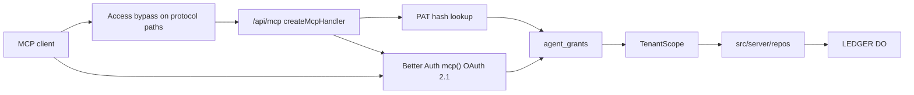

# Remote MCP server for agents (Streamable HTTP, OAuth 2.1 + personal tokens)

| Field              | Value |
| ------------------ | ----- |
| **Status**         | draft |
| **Issue**          | #844  |
| **Spec PR**        | #845  |
| **Implementation** | none  |

## 📝 TLDR

An MCP client (Grok Bot, Claude, ChatGPT, Inspector, anything that speaks Streamable HTTP) has no
way into a workspace today: the only authenticated door is a browser cookie session
(`src/server/auth/config.ts`, ADR 0011). This spec adds a **remote** MCP server on the existing
Worker at `POST/GET/DELETE /api/mcp`, authenticated with **OAuth 2.1 (DCR enabled) and personal
tokens**, each grant bound to **one user + one workspace**, creatable only by **owner/admin**, and
**paid-plan only**. Tools wrap existing tenant-scoped repositories; they do not invent SQL, money
arithmetic, or a REST API. WebMCP in the open tab is deferred. Library choice is ADR 0037
(`createMcpHandler` + MCP SDK v2; not `McpAgent`). This pull request is design-only.

## 📝 Problem Statement

Verified against `origin/develop` at `8f8bde8` (2026-11-04).

There is no MCP route, no OAuth-provider plugin, no API-key plugin, and no grant table. Better Auth
plugins in `src/server/auth/config.ts` are `admin`, `twoFactor`, `organization`. `AUTH_BASE_PATH` is
`/api/auth`, mounted by `src/routes/api/auth/$.ts`. Rate limits live in `RATE_LIMIT_RULES` on
`SESSIONS` KV. Workspace access is `createGuards` → `membershipRoleFor` → `createScope`
(`src/server/auth/guards.ts`, ADR 0002). Production Access is default-deny
(`docs/DEPLOY.md` §8.1); Polar and Resend already need path-scoped Bypass applications for that
reason. Staging is not behind Access.

Without this surface, an agent can only drive the product as a person in a browser. That is the
wrong grain: it cannot be scoped per resource and verb, it cannot be revoked independently of the
login session, and it cannot pass Access on production.

Owner decisions on #844 (Rafał, 2026-11-04) close the issue's seven questions. They are treated as
decided in [Resolved assumptions](#resolved-assumptions-owner--autonomous-defaults).

## 📝 Proposed Solution

A first-party **grant** is the unit of agent access. OAuth access tokens and personal tokens both
resolve to one grant row. Every MCP tool call:

1. Authenticates the bearer (OAuth resource-server verification or personal-token hash lookup).
2. Loads the grant; refuses if revoked, expired, or the workspace plan is `free`.
3. Re-reads `member` for that `userId` + `organizationId` (never a session claim).
4. Builds `TenantScope` through `createScope` / the existing guard seam, with
   `requireOrg({ organizationId })` as an **assertion**.
5. Intersects grant scopes with the current workspace role; refuses the tool if the verb is outside
   the intersection.
6. Calls the same repository functions the server functions already call, with Zod at the MCP
   boundary and again in the repository. Money writes go through `runWithLedgerBatch`
   (`src/server/ledger/batch.ts`, `docs/MONEY.md` §5).
7. Writes `agent_audit_log` (ids, tool, verb, outcome — **no amounts, no payloads, no notes**).

**Rejected alternatives**

| Alternative                                  | Why it lost                                                                     |
| -------------------------------------------- | ------------------------------------------------------------------------------- |
| WebMCP in the tab first                      | Owner: remote first. A tab-bound server cannot serve Claude/ChatGPT connectors. |
| OAuth only, or PAT only                      | Owner: both. Connectors need DCR; humans minting a token in settings need PAT.  |
| `McpAgent` Durable Object                    | Deprecated and feature-frozen; extra DO next to `LEDGER`. ADR 0037.             |
| `@modelcontextprotocol/sdk` v1 as the server | Legacy `McpServer`; SDK v2 lives in `@modelcontextprotocol/server`. ADR 0037.   |
| Cloudflare `OAuthResourceServer` as identity | Would parallel Better Auth. We already own login, 2FA, organisations.           |
| General REST/public API                      | Out of scope on the issue. MCP tools are the only new public contract.          |
| Bank connectors as tools                     | ADR 0008; `docs/agents/out-of-scope.md`.                                        |
| MCP on the free plan                         | Owner: paid only (`plus` and `household`).                                      |
| Agent deletes without confirm                | Owner: two-step confirmation.                                                   |

## 📝 Architecture

**Owner module:** `src/server/mcp/` (new). It is the only module that speaks MCP JSON-RPC and grant
resolution. Repositories stay the owners of rows. `src/lib/plans.ts` remains the only catalogue
(SPEC §8): a boolean feature `mcp` on each plan, `false` for `free`, `true` for `plus` and
`household`. `resolveLimits()` exposes it; the MCP authenticator throws `FeatureLockedError('mcp')`
before any tool runs.

**Reuse**

- `createGuards({ getSession, db })` already takes a session reader. MCP supplies a reader that
  synthesises `{ user, session: { activeOrganizationId: grant.organizationId } }` from a verified
  grant, or calls `requireOrgFrom` + `createScope` directly with the re-read membership. Do not
  fork `tenantFilter`.
- Server-function Zod schemas in `src/server/fns/*` are the tool input shapes. If a schema is not
  exported, export it; do not copy it.
- `runWithLedgerBatch` wraps every write tool.
- `FeatureLockedError` (`src/server/repos/errors.ts`) is the paid-plan refusal the public envelope
  already classifies (`FEATURE_LOCKED` → `feature_locked`).
- `assertRole(scope, action, 'admin')` (`src/server/repos/scope.ts`) is how mint/revoke/consent are
  limited to owner/admin. `roleSatisfies` already ranks `owner` above `admin` above `member`.
- Rate-limit counters in `SESSIONS` KV, same approximate-counter trade as
  `src/server/auth/config.ts` (`RATE_LIMIT_RULES`). MCP does **not** share those auth paths; it
  uses its own keys (`mcp:rl:grant:{id}:read|write|delete`).
- API route shape: `src/routes/api/webhooks/polar.ts` — cookie-free, `OPTIONS` allowed.

**New / planned**

Takeaway: the client never picks a workspace; the grant does. The ledger rebuild path does not
change.

**Cloudflare Access (document how; this PR does not change Zero Trust)**

Production is a site-wide Access application `money-tracker.online` with policy `team`
(`docs/DEPLOY.md` §8.1). Polar and Resend already require **separate Bypass applications** ordered
ahead of it, scoped to one path. MCP needs the same pattern. Implementation amends §8.1; a person
creates the applications in the dashboard. Suggested applications (path prefix, Bypass, ahead of
the site app):

| Application name (suggested)           | Path prefix to Bypass                                                                                                                                                                         | Why                                                      |
| -------------------------------------- | --------------------------------------------------------------------------------------------------------------------------------------------------------------------------------------------- | -------------------------------------------------------- |
| `money-tracker.online MCP`             | `/api/mcp`                                                                                                                                                                                    | Streamable HTTP. Clients have no Access JWT.             |
| `money-tracker.online MCP OAuth token` | `/oauth2/token` and `/oauth2/register` **or** the Better Auth equivalents under `/api/auth/` once the plugin's real paths are read from its docs at install time                              | Token and DCR must be reachable without an Access login. |
| `money-tracker.online MCP well-known`  | `/.well-known/oauth-protected-resource`, `/.well-known/oauth-protected-resource/api/mcp`, `/.well-known/oauth-authorization-server` (and issuer-inserted variants the plugin actually serves) | RFC 9728 / RFC 8414 discovery.                           |

**Do not Bypass `/sign-in`, `/oauth2/authorize`, or the consent page.** Those are human pages. Until
production Access is removed site-wide, only the `team` policy can complete OAuth consent in
production. Staging has no Access, so Inspector and connectors can be developed there first.
Personal tokens minted on a session that already passed Access (or on staging) then call `/api/mcp`
without Access.

This spec does not change GitHub settings, merge gates, or branch protection.

**Dependencies (implementation PR only, citing ADR 0037 and this spec)**

| Package                                                               | Role                                                                                                                                                                                    |
| --------------------------------------------------------------------- | --------------------------------------------------------------------------------------------------------------------------------------------------------------------------------------- |
| `agents`                                                              | `createMcpHandler` only (`agents/mcp/server`)                                                                                                                                           |
| `@modelcontextprotocol/server`                                        | SDK v2 `McpServer`; pin to the `agents` peer                                                                                                                                            |
| `@better-auth/mcp` (and its `@better-auth/oauth-provider` dependency) | OAuth 2.1 + DCR + protected-resource metadata                                                                                                                                           |
| `better-auth`                                                         | May need a caret bump so it satisfies `@better-auth/mcp`'s peer (`^1.7.16` on the day this was probed; tree today is `^1.7.1` / 1.7.2). Ask First on that bump; it is not this spec PR. |

Do **not** add `@better-auth/api-key`. Personal tokens are workspace-bound grants we own; the
API-key plugin is a user-level key store unless proven otherwise at implementation time, and that
proof is not required because a first-party table is the smaller lie.

Do **not** add `@cloudflare/workers-oauth-provider`.

## 📝 Data Model

Additive migration **0011** (0010 is `0010_lyrical_terror.sql` on develop: `was_planned` on
`transactions`). No drizzle files in this spec PR.

All new product tables carry `organization_id` as the leading column of every composite index
(SPEC §5.2). SQL lives in `src/server/repos`. Better Auth plugin tables (OAuth clients, codes,
tokens) are auth tables generated the way `auth-schema.ts` already is; they are not product tables
and stay behind ADR 0011's boundary.

### `agent_grants`

| Column            | Type         | Notes                                                |
| ----------------- | ------------ | ---------------------------------------------------- |
| `id`              | text PK      | `nanoid`                                             |
| `organization_id` | text         | tenant                                               |
| `user_id`         | text         | grantor; tools run as this member                    |
| `kind`            | text         | `oauth` \| `pat`                                     |
| `name`            | text         | person-chosen label; not a secret                    |
| `client_id`       | text null    | OAuth client id; null for PAT                        |
| `token_hash`      | text null    | SHA-256 of PAT secret; null for OAuth                |
| `token_prefix`    | text null    | public prefix shown in the list, e.g. `mto_stg_nwh_` |
| `scopes`          | text         | JSON array of `resource:verb` strings                |
| `created_at`      | integer      | ms                                                   |
| `revoked_at`      | integer null | set on revoke; never deleted in v1                   |
| `last_used_at`    | integer null |                                                      |

A PAT secret is shown **once** at creation. Store only `token_hash`. Compare with a constant-time
compare. Prefix is not enough to authenticate.

### `agent_audit_log`

| Column            | Type                                                                      | Notes               |
| ----------------- | ------------------------------------------------------------------------- | ------------------- |
| `id`              | text PK                                                                   |                     |
| `organization_id` | text                                                                      | tenant              |
| `grant_id`        | text                                                                      |                     |
| `user_id`         | text                                                                      |                     |
| `tool`            | text                                                                      |                     |
| `verb`            | `read` \| `write` \| `delete`                                             |                     |
| `resource`        | text                                                                      | e.g. `transactions` |
| `resource_id`     | text null                                                                 | id only             |
| `outcome`         | `ok` \| `denied` \| `not_found` \| `invalid` \| `rate_limited` \| `error` |                     |
| `created_at`      | integer                                                                   |                     |

No amounts, no payee names, no notes, no raw JSON-RPC params. Retention: keep until a later
privacy stage says otherwise; v1 does not ship a purge.

### Confirm-delete tickets

Not a D1 table. KV key `mcp:confirm:{grantId}:{token}` in `SESSIONS`, TTL **60 seconds**, value
`{ tool, resource, resourceId }`. The ticket is single-use.

### Plan catalogue

Add `mcp: boolean` to the plan definition (or an equivalent total `PlanFeatures` record). `free`:
`false`. `plus` / `household`: `true`. Copy keys for the feature sentence land in the same
implementation change as the catalogue row (SPEC §9).

## 📝 API Contracts

### MCP endpoint

- URL: `https://<host>/api/mcp`
- Transport: Streamable HTTP via `createMcpHandler` (ADR 0037)
- Methods: whatever the handler requires (`POST` plus `GET`/`DELETE`/`OPTIONS` as the SDK
  specifies). Unauthenticated calls return **401** with `WWW-Authenticate` pointing at protected
  resource metadata (RFC 9728), not a login HTML page.

### Scopes

Closed vocabulary. `resource` ∈ `accounts`, `transactions`, `categories`, `payees`, `recurring`,
`budgets`. `verb` ∈ `read`, `write`, `delete`. Wire form `transactions:write`. A write scope does
**not** imply delete. `delete` does not imply write. `read` is required to return a delete preview.

Effective permission = grant scopes ∩ current membership role ∩ plan feature. A `member` cannot
mint grants; if they somehow hold a grant (they should not in v1), tools still re-read the role
and `assertRole` on mint/revoke only. Tool execution uses the grantor's current role: if the
grantor is demoted to `member`, tools that the product already refuses to members keep refusing.

### Personal token HTTP

`Authorization: Bearer <secret>`. Secret matches `^mto_(stg|live)_[a-z0-9]+\\.[A-Za-z0-9_-]+$`
in the spec examples; the implementation may tighten. Staging vs live prefixes reduce accidental
cross-environment paste.

### OAuth 2.1

Better Auth `mcp()` with:

- `resource` = canonical MCP URL (`https://money-tracker.online/api/mcp` in production,
  staging host on staging). Tokens are audience-bound to that resource.
- `allowDynamicClientRegistration: true`
- `allowUnauthenticatedClientRegistration: true` (MCP public clients)
- `clientRegistrationDefaultApplicationType: "infer"` (localhost / custom-scheme clients)
- PKCE required
- Consent page lists **this workspace's name** and the requested scopes. Workspace is the grantor's
  active workspace at consent time and is stored on the grant; the client cannot send a different
  `organizationId`.
- DCR is enabled because the owner asked for it. Client ID Metadata Documents (CIMD) are **out of
  this spec's shipped phases** even though MCP 2026-07-28 prefers them. A later spec may add
  `@better-auth/cimd`.

### Tools (v1)

Every tool input is a Zod object. Amounts are integer minor units (`docs/MONEY.md` §1.1, §1.2).
`ref_amount_minor` is never sent in, never recomputed (`§3.1`). List tools that read transactions
take a required `policies` object of type `TransactionPolicies` — all four fields, no default
(`src/server/repos/transactions.ts`).

**Read**

| Tool                | Scope               | Wraps                                                                |
| ------------------- | ------------------- | -------------------------------------------------------------------- |
| `list_accounts`     | `accounts:read`     | account list + types                                                 |
| `get_balances`      | `accounts:read`     | account-balances read model                                          |
| `list_transactions` | `transactions:read` | paginated `ledgerPageFor` / transaction queries; `policies` required |
| `list_categories`   | `categories:read`   | category tree                                                        |
| `list_payees`       | `payees:read`       | payee list                                                           |
| `list_recurring`    | `recurring:read`    | series list                                                          |
| `list_budgets`      | `budgets:read`      | budgets for a month                                                  |
| `get_month_summary` | `budgets:read`      | existing month summary read model; integer minors only               |

**Write** (all inside `runWithLedgerBatch` when they touch money)

| Tool                                        | Scope                |
| ------------------------------------------- | -------------------- |
| `create_transaction` / `update_transaction` | `transactions:write` |
| `create_category` / `update_category`       | `categories:write`   |
| `create_payee` / `update_payee`             | `payees:write`       |
| `create_recurring` / `update_recurring`     | `recurring:write`    |
| `update_budget`                             | `budgets:write`      |

**Delete** (scope `*:delete`)

`delete_transaction`, `delete_category`, `delete_payee`, `delete_recurring` return a preview
`{ resource, id, labelKey, confirmToken, expiresInSec }` and do not mutate. `confirm_delete`
`{ confirmToken }` executes, then burns the ticket. A second confirm is `not_found`. Preview
`labelKey` is an i18n key plus params (ids, never amounts).

### Errors

Map to MCP tool errors with public envelope kinds (`docs/SPEC.md` §5 / failure classifier):
unauthenticated → 401 MCP initialize failure; `FEATURE_LOCKED` → tool error `feature_locked`;
missing scope → `denied`; other-tenant id → `not_found` (same as `e2e/tenant-isolation.spec.ts`);
validation → `invalid`; limiter → `rate_limited` with `retryAfterSec`. Do not put SQL, stacks, or
amounts in tool error text.

### Rate limit

Per grant, `SESSIONS` KV, 60-second window: read 60, write 20, delete 5. Per user across grants:
read 120, write 40, delete 10. Auth `RATE_LIMIT_RULES` stay as they are.

### Server functions (settings)

Cookie session, `requireOrg`, `assertRole(..., 'admin')`:

- `listAgentGrants`
- `createPersonalAccessToken` → `{ grant, token }` once
- `revokeAgentGrant`
- `listAgentAudit` (optional in phase 5; ids only)

## 📝 UI/UX

New route `/settings/agents`, linked from the workspace card on `/settings`
(`src/routes/_app/settings/index.tsx`). Scope badge: workspace (`settings.scope.workspace`).
Owner/admin on a paid plan: list, create PAT, revoke, copy MCP URL. Member: read-only empty
explanation (no token form). Free plan: locked panel + link to `/settings/billing`.

OAuth consent is a dedicated page, not a toast. Deny and Allow are 44×44 hit areas. Keyboard:
focus lands on the heading, then the scope list, then Deny, then Allow.

Revoke uses the existing confirm-dialog pattern (`src/routes/_app/accounts/-ui/confirm-dialog.tsx`
shape): title, consequence sentence, cancel, destructive confirm.

Empty, loading, error states on the list. Light and dark. 360 and 1280.

Prototype:

- `.ai/specs/assets/mcp-server-for-agents/mockup-01-settings-index.html`
- `.ai/specs/assets/mcp-server-for-agents/mockup-02-agents-empty.html`
- `.ai/specs/assets/mcp-server-for-agents/mockup-03-agents-list.html`
- `.ai/specs/assets/mcp-server-for-agents/mockup-04-oauth-consent.html`
- `.ai/specs/assets/mcp-server-for-agents/mockup-05-free-locked.html`

Static HTML only. Spec `AGENTS.md` forbids PNGs in `.ai/specs/`. Current-app screenshots were not
committed (same rule; no test-env boot in this run).

## Visual change expected

| Route              | States                                                                                    | Viewports / themes       |
| ------------------ | ----------------------------------------------------------------------------------------- | ------------------------ |
| `/settings`        | new "Connected agents" row on the workspace card                                          | 360 + 1280, light + dark |
| `/settings/agents` | empty, list, token-once flash, revoke dialog, free locked, member refused, error, loading | 360 + 1280, light + dark |
| OAuth consent      | pending, denied redirect                                                                  | 360 + 1280, light + dark |
| `/api/mcp`         | none (no HTML)                                                                            | n/a                      |

Implementation captures with `scripts/visual/capture.mjs`.

## Copy

Keys land in EN + PL in the same implementation change (`i18n-messages`). English source:

| Key                              | EN                                                                                    |
| -------------------------------- | ------------------------------------------------------------------------------------- |
| `settings.agents.title`          | Connected agents                                                                      |
| `settings.agents.subtitle`       | Tokens and apps that may read or change this workspace.                               |
| `settings.agents.empty`          | No agents have access to this workspace yet.                                          |
| `settings.agents.mcpUrl`         | MCP URL                                                                               |
| `settings.agents.createToken`    | Create a personal token                                                               |
| `settings.agents.tokenOnce`      | Copy this token now. It will not be shown again. Treat it like a password.            |
| `settings.agents.kind.pat`       | Personal token                                                                        |
| `settings.agents.kind.oauth`     | OAuth app                                                                             |
| `settings.agents.revoke`         | Revoke                                                                                |
| `settings.agents.revoke.title`   | Revoke {name}?                                                                        |
| `settings.agents.revoke.body`    | The next tool call with this grant fails. This does not delete rows it already wrote. |
| `settings.agents.revoke.confirm` | Revoke access                                                                         |
| `settings.agents.locked`         | Agent access is part of Plus and Household. The free plan does not include it.        |
| `settings.agents.locked.cta`     | See plans                                                                             |
| `settings.agents.membersOnly`    | Only an owner or admin can connect an agent.                                          |
| `oauth.consent.title`            | Allow {clientName}?                                                                   |
| `oauth.consent.body`             | This app is asking to use {workspaceName}. It cannot see any other workspace.         |
| `oauth.consent.allow`            | Allow                                                                                 |
| `oauth.consent.deny`             | Deny                                                                                  |
| `plans.feature.mcp`              | Connect agents through MCP                                                            |

Scope chips reuse resource/verb words already in the catalogue where they exist; new chip keys
follow `settings.agents.scope.{resource}.{verb}` if a dedicated string is needed.

## 📝 Edge Cases & Failure Scenarios

- Token for workspace X after membership removal: next call unauthenticated / not_found, not a
  leak of X's rows.
- Grantor demoted to member: cannot mint or revoke; existing tools still tenant-scoped; product
  write gates that require admin keep refusing.
- Free plan after downgrade: authenticator returns `feature_locked` even if the grant row remains.
  Revoke still allowed so the owner can clean up after they re-subscribe, or we allow revoke on
  locked plans (yes: revoke is a grant table update, not an MCP tool).
- Cross-tenant ids: `not_found`.
- Read-only grant calling write/delete: `denied`.
- Write grant calling delete: `denied`.
- Expired confirm token: `not_found`.
- Rate limit: `rate_limited`, no audit payload, audit outcome `rate_limited`.
- Ledger enqueue fails after a successful write: existing `runWithLedgerBatch` `finally` behaviour;
  nightly rebuild heals (`docs/MONEY.md` §5). MCP does not add a second rebuild path.
- Access still on `/` : browser UI in production remains team-only; MCP protocol paths Bypass.
- DCR client with `http://localhost` redirect: allowed via `infer` application type.
- Plugin well-known path not bypassed: client cannot discover OAuth; staging is the proving ground.
- Synthetic fixtures only. Never Rafał's real financial data.

## 📝 Risks & Impact Review

Hard to reverse: OAuth client ids in the wild, PAT prefixes, `/api/mcp` URL
(`BACKWARD_COMPATIBILITY.md` public URLs — add `/api/mcp` and the well-known/OAuth paths when they
ship). Schema 0011 is additive; dropping columns is a later release (SPEC §6.1).

New dependencies are freeze exceptions under ADR 0037 (transport) plus the Better Auth MCP plugin
in the implementation PR (Ask First, named here). Blast radius: auth schema regeneration, workerd
sign-in tests (ADR 0015).

Access Bypass widens the unauthenticated perimeter. Mitigations: path-scoped apps, token auth on
the Worker, no HTML grant on those paths, rate limits.

Money: every write is a ledger write. Tenant isolation and money-invariant tests are mandatory.

## 📋 Phasing

Phase 1 is the last phase that may add migration 0011. Later phases add no schema.

1. **Grants and PATs (no MCP traffic).** Tables, repos, mint/revoke server functions, plan feature
   flag, tenant-isolation tests. App still works; `/api/mcp` does not exist yet.
2. **OAuth + `/api/mcp` authenticate.** Add packages (ADR 0037), Better Auth `mcp()`, Access
   runbook in `DEPLOY.md` §8.1, handler that lists **zero** tools until phase 3. Inspector can
   connect and fail tools with `denied`/`empty`.
3. **Read tools.** The read table above. Isolation + policies required.
4. **Write and delete tools.** Ledger batch, two-step delete, money-invariant property test,
   audit rows.
5. **Settings UI + consent page.** Copy keys, visual captures, revoke, free locked.

Phase 5 is the last phase of this spec (UI). The coordinator puts `Closes #844` only on the last
implementation PR; this spec PR uses `Refs #844`.

## 📋 Implementation Plan

### Phase 1 — Grants

1. Additive Drizzle schema for `agent_grants` and `agent_audit_log` → migration **0011** via
   `pnpm db:generate`, never a hand-edited SQL file. Tenant-isolation: user A cannot list B's
   grants.
2. Catalogue: `mcp: boolean` on each plan; resolver exposes it; unit test that `free` is false
   and paid is true. Copy `plans.feature.mcp` in EN+PL.
3. Repo: create/list/revoke grants; PAT hash; `assertRole` admin on writes. Isolation cases for
   list/revoke. No money path yet.
4. Server functions + Zod for mint (returns token once) and revoke.

### Phase 2 — Transport and OAuth

1. Add `agents` and `@modelcontextprotocol/server` citing ADR 0037; add `@better-auth/mcp` with
   any `better-auth` peer bump (Ask First, same implementation PR). Lockfile freeze restored.
2. Route `src/routes/api/mcp.ts` composing `createMcpHandler` after grant auth. Workerd test:
   unauthenticated 401; no new DO export.
3. PAT and OAuth both resolve to a grant; revoked grant 401 on the next call. Isolation: A's
   token cannot authenticate as B.
4. Amend `docs/DEPLOY.md` §8.1 with the Bypass table; `BACKWARD_COMPATIBILITY.md` public URL row
   for `/api/mcp` and discovery paths. Do not change Cloudflare dashboard in the PR.

### Phase 3 — Reads

1. Register read tools; each calls existing repos with explicit `TransactionPolicies` where
   applicable. Isolation: every tool with B's ids → `not_found`.
2. Read-only grant is refused on write tool names even before phase 4 wires them (listTools
   filters by grant scopes).
3. `get_balances` / `get_month_summary` return integer minors only; a test fails if a number is
   formatted as a decimal string in the tool payload.

### Phase 4 — Writes and deletes

1. Write tools through existing fn Zod + `runWithLedgerBatch`. Money-invariant: N synthetic MCP
   writes, then balances equal the rebuilt ledger (`docs/MONEY.md` §5). Isolation on create/update.
2. Delete preview + `confirm_delete`; KV TTL 60s; second confirm `not_found`. Isolation on delete.
3. Audit row per call; test that the row has no amount field and the JSON does not contain the
   written minor units.
4. Rate-limit tests with a fake KV clock.

### Phase 5 — UI

1. `/settings/agents` + settings index link. Keys in EN+PL. Member and free states.
2. Consent page. Owner/admin only; member sees an error with `settings.agents.membersOnly`.
3. Visual captures 360/1280 light/dark; e2e keyboard path on the list and revoke dialog.

Each step leaves the app working. Phases 1–2 can ship without tools; clients simply have nothing
useful to call.

## Resolved assumptions (owner + autonomous defaults)

Owner decisions from https://github.com/design4pro/money-tracker.online/issues/844#issuecomment-3583878882
are not open questions.

| #   | Question                 | Applied default                                                                              | Why                                                            | Confirm?   |
| --- | ------------------------ | -------------------------------------------------------------------------------------------- | -------------------------------------------------------------- | ---------- |
| Q1  | Remote vs WebMCP         | Remote Streamable HTTP at `/api/mcp`; WebMCP deferred                                        | Owner 2026-11-04                                               | decided    |
| Q2  | OAuth vs PAT             | Both: OAuth 2.1 with DCR, and personal tokens                                                | Owner 2026-11-04                                               | decided    |
| Q3  | Library                  | `createMcpHandler` + `@modelcontextprotocol/server`; not `McpAgent`; not SDK v1 entry        | Probed CF docs + npm 2026-11-04; ADR 0037                      | decided    |
| Q4  | Production Access        | Path-scoped Bypass for MCP + OAuth protocol endpoints now; document, do not apply in this PR | Owner 2026-11-04                                               | decided    |
| Q5  | Deletes                  | Allowed, two-step confirm                                                                    | Owner 2026-11-04                                               | decided    |
| Q6  | Who grants               | Owner/admin only; one workspace per grant                                                    | Owner 2026-11-04                                               | decided    |
| Q7  | Plan gating              | Paid plans only (`plus`, `household`)                                                        | Owner 2026-11-04                                               | decided    |
| Q8  | CIMD alongside DCR?      | No in this spec                                                                              | Owner asked for DCR; CIMD is a later spec                      | reversible |
| Q9  | `@better-auth/api-key`?  | No; first-party hashed PAT on `agent_grants`                                                 | Workspace binding is ours                                      | reversible |
| Q10 | Confirm TTL              | 60s in `SESSIONS` KV                                                                         | Shortest ticket that still lets a client round-trip            | reversible |
| Q11 | v1 resources             | accounts, transactions, categories, payees, recurring, budgets                               | Matches the issue's tool list; goals/loans/rules/imports later | reversible |
| Q12 | Mint for another member? | No; grantor is the acting owner/admin                                                        | Least privilege                                                | reversible |
| Q13 | Audit retention          | Keep; no purge in v1                                                                         | Avoids a second migration                                      | reversible |
| Q14 | Rate limits              | 60/20/5 per grant per minute (read/write/delete)                                             | Below auth's generic 100/60; writes stricter                   | reversible |

No `⚠ NEEDS HUMAN CONFIRMATION` rows remain after the owner comment.

## Research (open-source / public MCP)

Compared against public remote-MCP patterns, not the reference product (`docs/agents/reference.md`).

- Cloudflare's own remote MCP templates now start from **stateless** `createMcpHandler`, not
  `McpAgent` — that deprecation is why ADR 0037 does not follow the issue's binary.
- Better Auth 1.7 documents `mcp()` as the OAuth provider for MCP, with DCR **opt-in** (CIMD
  preferred by MCP 2026-07-28). We enable DCR because the owner named it, and we document CIMD as
  deferred rather than silently skipping the 2026-07-28 profile.
- GitHub / Linear-style remote MCP: OAuth, resource-scoped tokens, revoke in an application
  settings screen. We copy the **shape** (consent, revoke, scoped tools), not names or layouts.
- Complexity we skip: a public REST API, WebMCP, CIMD, DPoP, MCP resources/prompts beyond tools,
  sampling, elicitation, a second Durable Object for session replay.

## Decisions in play

No `product-brief.md` in this tree. Relied-on ADRs: 0002 (tenant repos), 0006 / `docs/MONEY.md`
(integer minors), 0008 (no bank connectors), 0010 (ledger DO), 0011 (Better Auth), 0012 (plans),
0015 (workerd tests), 0037 (this spec's library record).
