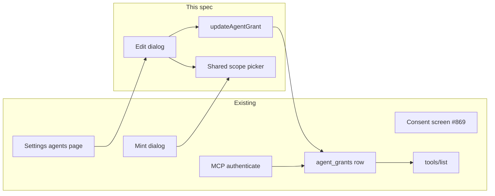

# Edit settings and permissions of a connected app

| Field              | Value |
| ------------------ | ----- |
| **Status**         | draft |
| **Issue**          | #870  |
| **Spec PR**        | none  |
| **Implementation** | none  |

## 📝 TLDR

An owner or admin can change the name and the `resource:verb` scopes of a connected OAuth app or personal token from Settings → Agents, and can see when that grant was last used, without a new OAuth round. Today the page mints, lists, and revokes. Name and scopes are fixed at insert. Proposed: one tenant-scoped update of `name` and `scopes` on the existing row. The next `tools/list` publishes `listedMcpToolNames` for the grant authenticate returns. A personal token is that row. An OAuth client with one live row is that row.

## 📝 Problem Statement

The person who connected an agent is an owner or admin of one workspace (#870, parent design #844). After Allow, or after a personal token is minted, the only way to drop a permission is Revoke, which kills the grant. Widening access means connecting again. The list already shows last used; the edit surface has to show it too, as a preview, because that is the signal for whether the app is still in use before the scope set changes.

Verified on `origin/develop` at `2f45215b`: `createPatGrant`, `createOauthGrant`, `listGrants`, and `revokeGrant` exist. There is no update of `name` or `scopes`. `loadAgentsPage` returns non-revoked grants to owner and admin. `toolContextForGrant` sets `scopes` from `scopesOfGrant(grant)`, and `listedMcpToolNames` is what `tools/list` publishes, including `confirm_delete` when any `:delete` scope is held. `registerMcpTools` builds a fresh server per request (ADR 0037). A write to the grant row is visible on the next call.

## 📝 Proposed Solution

Add `updateAgentGrant` beside revoke. The settings page gains an edit action on each active grant when agent access is on the plan. The dialog edits the name and the eighteen scopes, shows last used, and leaves revoke as the existing confirm dialog.

The scope checkboxes are one shared picker. #869 is adding that picker on the consent screen and making the newest live OAuth row the one `tools/list` uses. This spec consumes that picker when it exists. It does not change consent or `findOauthGrantByClient`.

Alternatives that lost:

- Re-consent to change scopes. The request is explicit that a scope change does not send the person through OAuth again, and a personal token has no consent screen.
- A new grant row per edit, with the old row revoked. That rotates the PAT secret and breaks a connector that already holds a token. The secret and the client id stay.
- Putting the eighteen scopes on the OAuth provider. #869 already refused that: clients send the OIDC set, and the grant row is the product permission.

## 📝 Architecture

Owner of the grant row: the agent-grant repository (`docs/SPEC.md` §8). The settings server function is a thin gate. MCP keeps reading the row it already loads. No new module.



Takeaway: mint and edit share the picker in this change. Consent keeps its own screen (#869). Only edit calls the new write. `tools/list` stays a read of whatever row authenticate returns.

Boundaries this design keeps: SQL in the tenant repository (ADR 0002, `docs/SPEC.md` §5.2 and §6.1). Zod on the server function and again in the repository; validation is shape. `assertRole(..., 'admin')` is owner or admin (`docs/SPEC.md` §5.3, ADR 0011: `requireOrg` re-reads the member row). The `mcp` plan feature is the billing gate (ADR 0012, `docs/SPEC.md` §5.4). React Aria checkboxes (ADR 0005). The accessibility claim stays the one in `docs/ACCESSIBILITY.md` (ADR 0009, `docs/SPEC.md` §10). Copy in both catalogues (`docs/SPEC.md` §9). Bank connectors stay out (`docs/agents/out-of-scope.md`, ADR 0008). No plan stage under `docs/plans/` covers this screen.

`components/ui` does not fetch and does not import `server/`. The route module calls the server function and passes `onUpdate`, the same way it passes `onRevoke`.

## 📝 Data Model

No migration. The next number would be `0013`, and this change does not need it. `agent_grants.name` (max 80), `scopes` (JSON array of the closed set), and `last_used_at` already exist.

The update writes `name` and `scopes` only. `scopes` is stored as `JSON.stringify` of the unique, sorted list, the same as create. Untouched columns: `user_id`, `organization_id`, `kind`, `client_id`, `token_hash`, `token_prefix`, `created_at`, `revoked_at`, `last_used_at`.

A revoked row is not a write target. Missing id and revoked id both surface as not found, and the row is unchanged. Revoke of an already-revoked row stays idempotent success; update does not copy that, because a successful update would look like the grant is active.

No audit row. `insertAgentAudit` requires a tool, a resource, and a verb. A settings edit is not an MCP tool call. The grant row is the record.

Sensitive data: the update never returns `token_hash` or the PAT secret. `AgentGrantView` is the response, as for list and revoke.

## 📝 API Contracts

Repository, first argument `TenantScope`:

```ts
updateAgentGrant(
  scope: TenantScope,
  input: UpdateAgentGrantInput,
  now: Date,
): Promise<AgentGrantView>
```

`UpdateAgentGrantInput`, parsed with `z.strictObject` in the repository and by the server function:

- `grantId`: trimmed string, length 1–64
- `name`: trimmed string, length 1–80
- `scopes`: array of the closed `AgentScope` union, length 1–18, then unique and sorted

`assertRole(scope, 'update an agent grant', 'admin')` before the write. Load through the tenant repository. Unknown id or `revokedAt` set: `NotFoundError`, no write.

Server function `updateAgentGrant`, `POST`, same input. Order matches mint: `requireOrg`, then the `mcp` feature (`FeatureLockedError` `mcp` when the plan lacks it), then the repository. Revoke stays callable when the feature is locked.

Errors the dialog already knows how to show through the failure panel: forbidden, feature locked, not found, invalid shape. No new public URL. `BACKWARD_COMPATIBILITY.md` discovery paths and `/api/mcp` stay. The scope JSON remains an array of `resource:verb` strings.

## 📝 UI/UX

`/settings/agents`, owner or admin, plan includes agent access (`page.kind === 'ready'`): each grant row gains an Edit control beside Revoke. Edit opens a dialog:

- Title uses the current name.
- Name field, labelled, required. Initial value is the grant's name.
- Last used, read-only, the same calendar-day formatting the list already uses, or the existing "Never" string.
- Kind and, for a personal token, the prefix, read-only, so the person can see which secret they are editing. The secret is not shown.
- The shared scope picker, initial value the grant's scopes. Label is the existing "Access" string. At least one box stays checked; an empty submit shows the new validation sentence and does not close.
- Save uses the existing Save string. Cancel closes with no write. Pending uses `isPending` on Save.
- Revoke stays the row action and the existing confirm dialog. It is not a second submit of this form.

Member: the page stays the members-only empty state. No edit control.

Plan without agent access: the locked card and the list stay. Revoke stays. Edit is absent, matching Create.

Keyboard: the dialog is the existing modal. Focus moves into it on open and returns on close. Checkboxes are reachable in order. Targets stay on the 44px hit area. The empty-scope error is text, not colour alone. Light and dark, 360 and 1280.

Shared picker: one component, props for the selected values and the change handler, rendering `AGENT_SCOPES` with `scopeMessageKey`. It does not fetch. If #869 has already extracted it, this dialog imports that component and the mint dialog's guideline in `DESIGN.md` is extended only when this third call site needs a sentence the guideline lacks (the empty-selection error). If the picker still lives inline in the mint dialog, this change extracts it, points the mint dialog and this dialog at it, and writes the `DESIGN.md` component guideline in that same change (Second Call Site Rule): shape, that every box is one `resource:verb` and write does not imply delete, states (checked, unchecked, focus, disabled, invalid group), the text label that survives without colour, and that it is not the consent summary list. This change does not edit the consent screen.

Prototype: `.ai/specs/assets/edit-connected-app-settings/mockup-01-edit-grant.html`

## Visual change expected

| Route              | States                                                                                 | Viewports / themes       |
| ------------------ | -------------------------------------------------------------------------------------- | ------------------------ |
| `/settings/agents` | edit dialog for an OAuth grant and for a PAT; empty-scope invalid; member; plan locked | 360 + 1280, light + dark |
| `/consent`         | none from this spec                                                                    | n/a                      |
| `/api/mcp`         | none (the tool list changes content; the route does not)                               | n/a                      |

The list, including its last-used column, stays. Implementation captures with `scripts/visual/capture.mjs` when it builds the screen.

## Copy

New keys land in EN and PL in the same implementation change (`i18n-messages`). English source:

| Key                                   | EN                              |
| ------------------------------------- | ------------------------------- |
| `settings.agents.edit`                | Edit settings                   |
| `settings.agents.edit.action`         | Edit settings for {name}        |
| `settings.agents.edit.title`          | Settings for {name}             |
| `settings.agents.edit.saved`          | Access for {name} was updated.  |
| `settings.agents.edit.scopesRequired` | Choose at least one permission. |

Reused, unchanged: `settings.agents.tokenName`, `settings.agents.scopesLabel`, `settings.agents.column.lastUsed`, `settings.agents.neverUsed`, `settings.agents.scope.{resource}.{verb}`, `settings.agents.kind.pat`, `settings.agents.kind.oauth`, `action.save`, `action.cancel`, `settings.agents.revoke` and its confirm keys, `settings.agents.locked`, `settings.agents.membersOnly`. No new plural.

## 📝 Edge Cases & Failure Scenarios

- Other workspace's grant id: not found, that row unchanged. Tenant-isolation case on `updateAgentGrant`.
- Member of the grant's workspace: forbidden. The repository checks the role; the server function does not treat a hidden button as the permission.
- Revoked id, including one the list no longer shows: not found, `revoked_at` and `scopes` unchanged.
- Empty scope list, unknown scope, blank name, name longer than 80, extra fields: invalid, no write.
- Duplicate scopes in the array: stored once, sorted.
- Save with the same name and scopes: the write may repeat the same values. `last_used_at` stays.
- PAT after save: the same secret still hashes to `token_hash`. OAuth after save: `client_id` unchanged.
- Two admins save the same grant: last write wins. No version column.
- Several live OAuth rows for one client: each row is its own edit. Which row `tools/list` loads is #869 (`findOauthGrantByClient`). This update changes only the id it was given.
- Plan loses `mcp` after the grant exists: edit returns feature locked. Revoke still succeeds. The next tool call stays on the authenticator's existing locked behaviour from the parent spec.
- Grantor later demoted to member: an owner or admin can still edit the row. `user_id` stays the grantor. Tool execution keeps using that member's current role, as the parent spec already says.
- Dialog submit fails: the failure panel shows inside the dialog, the dialog stays open, the list stays on the previous values.
- `tools/list` after a successful save, same token: the names from `listedMcpToolNames` on the new scope set. Dropping every `:delete` drops `confirm_delete`. Adding `transactions:write` adds that write tool. No new token.

Money: this path does not read or write an amount, a rate, a currency, or a money date bucket (`docs/MONEY.md` is not in play). `last_used_at` is a usage timestamp and this update does not recompute it. No money-invariant case.

## 📝 Risks & Impact Review

The risky write is a wider scope set on a live token. It takes effect on the next request because the handler is stateless (ADR 0037). Rollback is another save that puts the previous set back, or revoke. There is no migration to roll back.

A downgraded workspace cannot widen scopes through this dialog while the feature gate holds. Revoke remains the cleanup.

Discovery URLs and stored token secrets are unchanged, so existing connectors keep working. Their effective permissions change only when an owner saves.

## 📝 Research

[Firefly III's personal-access-token screen](https://github.com/firefly-iii/firefly-iii/blob/e3da2fe0/resources/assets/v1/src/components/passport/PersonalAccessTokens.vue) creates a named token with optional scopes and revokes it. The same profile's OAuth client update changes the client name and redirect URIs, not the token's scopes. [Actual Budget's API-token proposal](https://github.com/actualbudget/actual/pull/8013) is per budget file, shown once, with revoke, disable, expiry, and last use, and without a per-resource verb editor. This spec takes the useful part of both (name, last used, revoke, scopes chosen by the person) and skips expiry, disable, and a general REST scope language. The eighteen `resource:verb` values and the one-workspace grant are already the product.

## 📋 Phasing

Phase 1 is the whole change: the repository write, the server function, the shared picker, and the dialog. One product area, no migration, one implementation pull request. #869 stays a separate change.

## 📋 Implementation Plan

### Phase 1: Edit a live grant

1. **Repository write.** Add `updateAgentGrant` as specified above. Tenant-isolation case: workspace A cannot update workspace B's id (not found, row unchanged); a member of A's workspace is forbidden. Money invariant: n/a, no amount, rate, currency, or money date bucket. The app keeps minting and revoking.
2. **Server function.** `updateAgentGrant` with the schema and the `mcp` feature gate. Tests: feature locked does not write; a revoked id does not write; a happy path returns the view with the new name and scopes and the same `tokenPrefix` / `clientId` / `lastUsedAt`. Money invariant: n/a.
3. **Picker.** If a shared scope picker is already in the tree, import it. Otherwise extract the checkbox group from the mint dialog, point mint and this dialog at it, and add the `DESIGN.md` guideline in that change. Leave the consent screen and `findOauthGrantByClient` untouched. Mint's existing tests still pass. No new copy in this step. This step ships with the dialog. When an open branch is adding the same component for #869, base the implementation on that branch so the file is added once. The write in steps 1–2 does not wait on that branch: a personal token and a single OAuth row change `tools/list` as soon as the update lands.
4. **Dialog and copy.** Edit action and dialog as in UI/UX. Keys in the table above in EN and PL. Page test: save calls `onUpdate` with the edited name and scopes; empty scopes do not call it; a member page and a locked page render no edit action; revoke still opens. Visual change: the states in the table above.
5. **Tool list follows the row.** A test builds a grant, updates its scopes, and asserts `listedMcpToolNames(scopesOfGrant(row))` gained the write tool and lost `confirm_delete` when the delete scopes are gone. No new token, no HTTP. Money invariant: n/a.

Each step leaves the app working. Step 4 is the first one a person can see.

## Resolved assumptions (autonomous defaults)

| #   | Question                                                     | Applied default                                                                                                                                   | Why                                                                                                                           |
| --- | ------------------------------------------------------------ | ------------------------------------------------------------------------------------------------------------------------------------------------- | ----------------------------------------------------------------------------------------------------------------------------- |
| Q1  | Ship the consent picker in this spec?                        | No. #869 owns consent and the newest-grant lookup. This change extracts the picker from the mint dialog when the tree does not already share one. | The edit ships on its own. Consent stays a separate defect.                                                                   |
| Q2  | Add migration `0013`?                                        | No.                                                                                                                                               | `name`, `scopes`, and `last_used_at` already exist. A migration would be the larger, harder-to-reverse choice.                |
| Q3  | May an owner edit scopes after the plan loses agent access?  | No. The server function uses the same `mcp` feature gate as mint. Revoke stays available.                                                         | Widening a lapsed grant would weaken the plan gate (ADR 0012). Revoke is the existing cleanup.                                |
| Q4  | Write an audit row for the edit?                             | No.                                                                                                                                               | The audit table is tool, resource, and verb. Inventing a settings event is a new contract. The grant row records the new set. |
| Q5  | Confirm again when the save adds a scope?                    | No. Save in the dialog is the confirmation, same as mint.                                                                                         | A second dialog is extra surface. The checkboxes are the selection.                                                           |
| Q6  | Hide OAuth rows that are not the one `tools/list` will load? | No. Edit and revoke by grant id. The lookup stays #869.                                                                                           | Hiding rows would drop the owner's way to revoke a duplicate.                                                                 |

Correct any row on the spec pull request before implementation.
